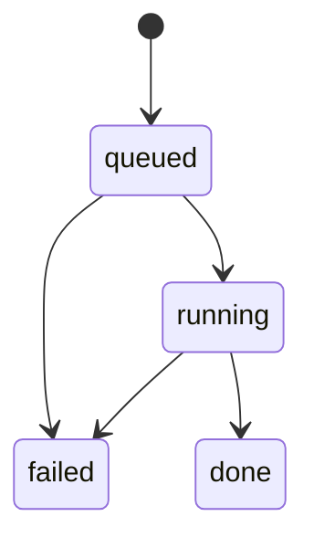

# State machines

Generated by `scripts/gen_state_docs.py` from the transition tables in code.
Do not edit by hand: change the table, then re-run the script. CI runs it with
`--check`. Design and rollout: [STATE_MACHINES_PLAN.md](STATE_MACHINES_PLAN.md).

## OCR job

Owner: `omniocr.ports.interfaces`. Initial: `queued`. Terminal: `done`, `failed`, `not_found`.
Entered from outside the machine: `not_found`

| State | May move to |
|---|---|
| `queued` | `failed`, `running` |
| `running` | `done`, `failed` |
| `done` | (terminal) |
| `failed` | (terminal) |
| `not_found` | (terminal) |
